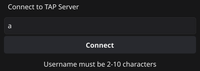
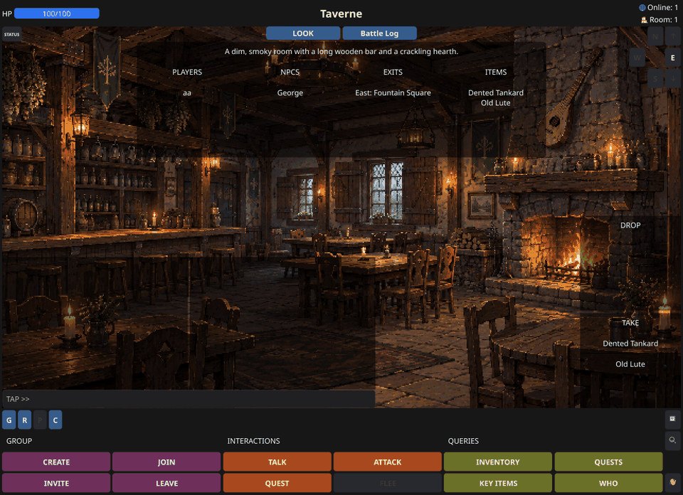
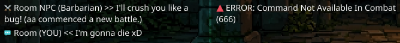
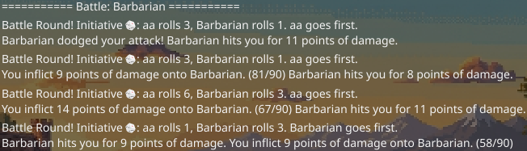
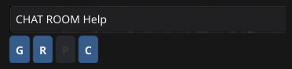
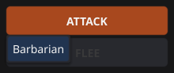

# TAP GUI — HUD Design Record

*42 school project "The Answer Protocol" (TAP): design decisions for the GUI client's game screen. Last updated 2026-10-17.*

Legend: **[R]** required by the subject PDF or RFC 42TAP · **[O]** optional, not mentioned in the subject but allowed · **[ext]** uses a server extension (a command not in the RFC).

Screenshots are in `Resources/`.

---

## 1. Basics

- Go with Fyne v2.8.1. Files in `GUI/`:
  - `gui.go`: entry point, window and channels
  - `loginScreen.go`, `gameScreen.go`, `overlay.go`, `chatWindows.go`, `buttonObjects.go`, `listObjects.go`, `zoneImages.go`, `uiThemes.go`: screens, widgets and button themes
  - `commandRouter.go`, `replyHandlers.go`, `battleScreen.go`, `serverPoll.go`: the router goroutine, its handlers and the LOOK poll
  - `serverConnection.go`: the TCP connection
  - `serverResponseParser.go`: turns each server line into a typed reply
  - `utils.go`: label helpers
- Fixed window of 1280 × 900, designed for a 1920 × 1080 screen. The zone background image is 640 × 360 pixel art shown at 2× (1280 × 720); the rest of the height holds the top row and the bottom section.
- The login window is 400 × 200.

  

- Many widgets sit on top of the background image. A show/hide button lets players see the artwork (section 10).
- All choices follow the subject PDF (V.4 GUI Client) and RFC 42TAP. The PDF requires CLI and GUI clients to be interchangeable between groups, so the GUI accepts both the RFC and the PDF forms of a reply where they differ, and server extensions have a fallback (section 9).

---

## 2. Layout diagram

Numbers match the element table in section 3. Positions are approximate; the diagram uses plain ASCII so it lines up in any font.

```
+----------------------------------------------------------------------------+
| [1] HP [######----]            [2] ROOM NAME                [3] Online: 12 |
+----------------------------------------------------------------------------+
| [4] [STATUS]              [6] [LOOK] [Battle Log]             [8] Room: 2  |
| [5] status panel      +-------------------------+           [9]   N   up   |
|                       | [7] zone info:          |               W   E      |
|  BG: zone background  | description, players,   |                 S   down |
|  1280 x 720, 2x art   | NPCs, exits, items      |                          |
|                       | (or [22] battle log)    |          [10] DROP       |
|                       +-------------------------+          +-------------+ |
|                                                            | inventory   | |
|                                                            +-------------+ |
| [12] error pop-up (fades after 3 s)                        [11] TAKE       |
| +----------------------+ +----------------------+          +-------------+ |
| | [13] CHAT            | | [14] LOG             |          | room items  | |
| +----------------------+ +----------------------+          +-------------+ |
| [15] [ manual command ...                       ]                          |
+----------------------------------------------------------------------------+
| [16] [G] [R] [P] [C]                                            [20] [S/H] |
|      GROUP                INTERACTIONS            QUERIES       [23] [EXA] |
| [17] [CREATE] [JOIN]  [18] [TALK ] [ATTACK]  [19] [INVENTORY] [QUESTS]     |
|      [INVITE] [LEAVE]      [QUEST] [FLEE  ]       [KEY ITEMS] [WHO   ]     |
|                                                                [21] [Quit] |
+----------------------------------------------------------------------------+
```



---

## 3. Elements

| # | Element | What it does | Req |
|---|---|---|---|
| 1 | HP bar | Top row, left. Current/max HP. Updated from STATUS replies and from every ATTACK reply. | [O] |
| 2 | Room name | Top row, centre. Current room name from LOOK. | [R] (room details) |
| 3 | `🌐 Online: #` | Top row, hard right. Players on the server, from `EVT STATS players=` (sent after login and on every login/logout). A WHO reply also updates it. | [R] counter |
| 4 | STATUS button | On the image, top-left, with small text. Shows or hides the status panel (5); opening the panel sends STATUS and GOLD. | [R] STATUS |
| 5 | Status panel | Below 4, hidden at start. The server's own status string from STATUS (e.g. healthy / weakened / injured / engaged), the gold amount from GOLD, and `In Party: ✔️` or `✖️` (section 8). The labels update whether the panel is showing or not. | [O] · gold [ext] |
| 6 | LOOK and Battle Log buttons | Centred, side by side. **LOOK** sends LOOK and shows the zone info box (7); **Battle Log** shows the battle log (22). Each button toggles its own panel and hides the other. | [R] LOOK |
| 7 | Zone info box | Below 6, centred. A description row on top, then four columns: Players, NPCs, Exits, Items, each sorted and scrolling after 4 entries. Exit rows read `Direction: Destination` (e.g. `East: Fountain Square`). Updates live whether showing or not (section 12). Shown at start. | [R] |
| 8 | `🏠 Room: #` | On the image, hard right. Players in the current room: set from LOOK's players list and adjusted by presence events (section 12). | [R] counter |
| 9 | D-pad | Right side, below 8. MOVE buttons (north, south, east, west, up, down). Only the exits of the latest LOOK reply are enabled (section 8). | [R] MOVE |
| 10 | DROP list | Right side, below the d-pad. The player's inventory, 4 rows before it scrolls. **Clicking an item sends `DROP <item-id>`.** Updated from INVENTORY replies and straight from the player's own `OK taken=` / `OK dropped=` replies. | [R] inventory, DROP |
| 11 | TAKE list | Below the DROP list, same style. The room's items from LOOK. **Clicking an item sends `TAKE <item-id>`.** | [R] TAKE |
| 12 | Error pop-up | On the image, left, above the chat window. Shows an error, then fades after 3 seconds. Errors are also written to the log. | [O] |
| 13 | Chat window | Bottom left of the image. Chat messages (including the player's own), NPC dialogue and NPC fight announcements (section 4). | [R] |
| 14 | Log window | Next to the chat window. Everything else (section 4). | [R] |
| 15 | Manual command entry | Under both chat windows, spanning their width (section 11). | [O] |
| 16 | Chat buttons | Bottom section, top left: **G**, **R** and **P** fill the manual entry with `CHAT GLOBAL `, `CHAT ROOM ` or `CHAT GROUP ` and focus it; **C** clears it. **P** is enabled only while the player is in a group (section 8). | [R] chat |
| 17 | GROUP buttons | 2 × 2 grid. **CREATE** and **LEAVE** send their command; **INVITE** and **JOIN** fill the manual entry with `GROUP INVITE ` / `GROUP JOIN ` for the name. Group replies and events are written to the log. | [R] GROUP |
| 18 | INTERACTIONS buttons | 2 × 2 grid. **TALK**, **ATTACK** and **QUEST** open a pop-up menu of the NPCs in the room (from LOOK's `npcs` list); clicking one sends the command with the NPC ID. **FLEE** is enabled only during a fight (section 7). | [R] TALK, ATTACK, QUEST · FLEE [O][ext] |
| 19 | QUERIES buttons | 2 × 2 grid: INVENTORY, QUESTS, KEYITEMS, WHO. Results are formatted log lines (section 5). | [R] buttons |
| 20 | Show/Hide UI | Bottom section, right column, top (section 10). | [O] |
| 21 | Quit (👋) | Bottom section, right column, bottom. Sends QUIT through the normal command path. | [R] QUIT |
| 22 | Battle log | Shares the zone info box's space (7). Opens by itself during a fight and shows one entry per round (section 7). | [O] |
| 23 | EXAMINE (🔍) | Bottom section, right column, under 20. Opens a menu (NPC, ITEM, KEY ITEM) that fills the manual entry with `EXAMINE NPC `, `EXAMINE ITEM ` or `EXAMINE KEYITEM `; it sends nothing itself. The reply is written to the log. | [O][ext] |


---

## 4. Chat window and log window

- Two separate windows, no tabs. The PDF requires the chat view (Global / Room / Group) to be separate from the log view.
- Both windows scroll so players can read the history. New messages scroll into view **only when the player is already at the bottom**. Each window keeps the last 250 lines.
- Every line starts with an emoji that shows its kind (e.g. 💬 chat, 🗣️ NPC dialogue, 📜 quests, 🔺 errors).

**Chat window**

| Source | Shown as |
|---|---|
| Another player's chat (`EVT <scope> CHAT`) | `💬 Global (pname) >> message` (scope: Global, Room or Group) |
| The player's own chat | `💬 Global (YOU) << message`, added by the client as soon as it is sent |
| NPC fight announcement (`EVT ROOM CHAT <<npc.id>> …`) | `⚔️ Room NPC (Cave Bat) >> …` for a fight start, `💬` for other announcements; the NPC ID is turned into a label (section 8) |
| NPC dialogue (TALK reply) | `🗣️ NPC (George): dialogue`, or `💖` for a healer's heal line (section 6) |

- The server does not send a chat message back to its sender, so the client adds the player's own line itself. This gives the immediate feedback players know from online RPGs. If the server rejects the message (for example not in a group, rate limit), the error is shown as for any other command.

**Log window**

- Everything else: query results, EXAMINE results, quest messages and rewards, take/drop, presence, group changes, respawn and errors.
- Errors also appear in the 3-second pop-up (12).
- A server line the parser doesn't recognise is written to the log as it is, so nothing from another server is silently lost.



---

## 5. Query buttons (19)

- Each press sends the command, and the result is written to the log as a formatted line, with names derived from IDs (section 8). Typed commands (section 11) are handled the same way.
- LOOK (6) and STATUS (4) are not in this grid; their results go to the zone info box and the status panel, not the log.
- WHO, QUESTS and KEYITEMS are never sent automatically, so their replies are always logged. An INVENTORY reply always updates the DROP list (10), but is only logged when the player asked for it.
- **Empty lists:** INVENTORY, KEYITEMS and QUESTS all answer an empty result with `OK []`, and replies don't name their command. The GUI remembers the last of these three commands the player sent and writes the matching "None" line. If two different ones are sent before the first reply arrives, the line can name the wrong command (a known limitation, listed in the README).
- On a server without KEYITEMS, the server's own error is shown.

---

## 6. NPC dialogue

- RFC 42TAP shows the TALK reply as plain text (`OK <dialogue>`); the subject PDF shows JSON (`OK { "npc": …, "dialogue": … }`). This project's server sends the JSON form, and the GUI accepts both:
  - JSON with a non-empty `dialogue`: the text and the NPC come from the reply.
  - Anything else after `OK `: the whole text is the dialogue, and the NPC is the target of the player's last TALK command.
- The line goes to the chat window as `🗣️ NPC (<name>): <dialogue>`, with the name turned into a label (section 8). If no name is known, it reads `NPC (NPC)`.
- A dialogue that contains `(You feel a warm glow)` (this server's healer suffix) is shown with 💖 and makes the GUI send STATUS, so the HP bar updates after healing.

---

## 7. Battle log (22)

- **Placement:** shares the zone info box's space; only one of the two is visible at a time. The Battle Log button (6) shows it at any time, so a finished fight can be reviewed.
- **Opens** by itself on the first ATTACK reply of a fight, scrolled to the newest entry. The FLEE button (18) is enabled at the same time.
- **Content:**
  - a start line `=== Battle: <name> ===` when the opponent differs from the previous fight's;
  - one entry per ATTACK reply: a 🎲 line with both initiative rolls and who goes first, then the hits and dodges in initiative order, with the enemy's HP after the player's hit (a side defeated before its turn is left out);
  - `🏃 You fled the battle.` after FLEE;
  - an end line of asterisks when a fight ends.
- **A fight ends** on:
  - an ATTACK reply with the player's or the enemy's HP at 0;
  - `OK battle ended` (FLEE);
  - `EVT RESPAWN`;
  - `OK room=` (a successful move);
  - a dropped connection or quitting (the log is cleared).
- When a fight ends, FLEE is disabled again, and the log stays visible for **5 seconds**, then hides. A new fight within those 5 seconds keeps it open.
- **10 seconds without an ATTACK reply** also leaves fight mode, as a safety net for servers whose end replies the GUI can't read. The timeout writes no end line and leaves FLEE enabled, since the fight may still be running on the server; a later ATTACK against the same opponent continues in the same section of the log.
- The fight end is detected from HP values rather than the `status` string, since status words differ between servers.



---

## 8. Bottom section and labels

The bottom section sits below the image (16–21, 23). Taking and dropping items is done with the TAKE and DROP lists (10, 11).

- **Layout:** three columns of 2 × 2 button grids, GROUP, INTERACTIONS and QUERIES, each with a label above it; the chat buttons (16) sit above the GROUP grid. All twelve grid buttons line up along the bottom edge. Show/Hide and Quit sit on the right.
- **Text input:** buttons that need text (chat scopes, group invite and join) fill the manual entry (15) with the command and leave the cursor at the end, so no separate dialogue box is needed. Group chat outside a group simply shows the server's error (ERR 401 NOT_IN_GROUP).

  

- **NPC menus:** the TALK, ATTACK and QUEST menus are built when the button is clicked, from the NPC list of the latest LOOK reply; an empty room shows "No Valid Target".

  

- **IDs and names:** menus and item lists send the item/NPC ID. The server accepts either IDs or display names, and so does the manual entry.
- **Labels:** made from IDs on the client only, with no extra requests. The exact prefixes `item.`, `key_item.`, `npc.`, `quest.`, `zone.`, `room.` and `loc.` are removed (a `.` elsewhere in a name is kept, since other servers may use one), and the rest is converted from snake case to words: `npc.father_tieu` becomes `Father Tieu`, `zone.fountain_square` becomes `Fountain Square`. Labels behave the same on every server.
- **FLEE** uses the server's FLEE command. It stays in the grid and is disabled outside a fight rather than hidden, so the grid keeps its shape. During a fight the server rejects MOVE, TAKE, DROP and QUEST.
- **Group state:** the GUI tracks whether the player is in a group from the group replies and events: CREATE, JOIN and the player's own LEAVE (also sent to every member when the leader leaves and the group is disbanded). A JOIN event that arrives while the player is already in a group means another player joined. This state drives the In Party label (5) and the P button (16).
- **D-pad:** only the exits of the latest LOOK reply are enabled. Right after a MOVE, the previous room's exits stay enabled until the new LOOK reply arrives; a click in that moment just gets ERR 301 NO_EXIT.
- **Rate limits:** no widget is locked on ERR 747 or ERR 750; the server's error is shown like any other.
- **Colours:** each button group has its own colour through Fyne theme overrides (`uiThemes.go`): steel blue for the chat buttons and LOOK / Battle Log, plum for GROUP, rust for INTERACTIONS and olive for QUERIES.

---

## 9. Server extensions and PDF V.4 coverage

Extensions not in the RFC: GOLD, KEYITEMS, EXAMINE, FLEE and the JSON reply of WHO. On a server that doesn't support one, the server's own error is shown in the pop-up and the log. The EXAMINE button (23) only fills the manual entry, so nothing is sent unless the player completes and submits the command.

| PDF V.4 requirement | Where |
|---|---|
| Room details, items, NPCs, exits with real-time updates | 7 (LOOK poll, section 12) |
| Player inventory plus TAKE / DROP buttons | 10 (DROP), 11 (TAKE) |
| Item IDs and display names handled | lists and menus send IDs and show labels; manual entry 15 accepts both |
| Room view updated after TAKE / DROP | LOOK sent after the reply; inventory updated from the reply |
| Chat view (Global / Room / Group) separate from the log | 13 and 14 |
| Buttons for LOOK, MOVE, TAKE, DROP, TALK, ATTACK, STATUS, QUEST, QUESTS, WHO, GROUP, QUIT | 6, 9, 11, 10, 18, 4, 19, 17, 21 |
| Counters for players in the room and on the server | 8 and 3 |
| NPC interaction with TALK and dialogue display | TALK menu (18), chat window |

---

## 10. Show/Hide UI (20)

- Hides the overlays on the image (LOOK and Battle Log buttons with their panels, status and gold, chat and log windows with the manual entry, d-pad and item lists) so the artwork is visible, and shows them again exactly as they were: each element keeps its own visible or hidden state. The top row and the bottom section stay visible.
- The button shows 🖼️ while the overlays are visible and 👀 while they are hidden.

---

## 11. Manual command entry (15)

- A permanent field under the chat windows for players who prefer typing commands (also useful for testing). The chat and group buttons fill it for commands that need text (section 8).
- Typed commands go through the same path as button commands, so the same rules apply (e.g. a typed INVENTORY, KEYITEMS or QUESTS counts for the empty-list matching in section 5).
- A typed `QUIT` closes the program, like the Quit button.
- A typed `CHAT <scope> <text>` also adds the player's own line to the chat window (section 4).
- The targets of `ATTACK` and `TALK` commands are remembered for the battle log and for naming the NPC in plain-text dialogue.

---

## 12. Data refresh plan

- **LOOK:** after login, after `OK room=`, `EVT RESPAWN` and the player's own `OK taken=` / `OK dropped=`, and **polled every 3.5 seconds** while other players are in the room, because the protocol has no item events. Alone in a room, nothing can change the room without the player's own actions, which already trigger a LOOK.
- **STATUS:** after login, respawn, a healer's heal line, and each time the status panel is opened.
- **GOLD:** after login, after a gold reward to the player (the reward line names the receiver), and each time the status panel is opened.
- **Inventory:** updated straight from the player's own take/drop replies; an INVENTORY reply replaces the whole list.
- The `🏠 Room: #` counter (8) is set from each LOOK reply and adjusted by one for every `EVT ROOM PRESENCE ENTER` (+1) or `LEAVE` (−1).
- Server player count comes from `EVT STATS`. WHO, QUESTS and KEYITEMS are never sent automatically.
- All automatic read-only queries go through the server's query bucket; the poll uses about a third of its refill.

---

## 13. Server-side changes made for the GUI

- Rate limits tuned for GUI play: the main bucket has capacity 12 and refills 1.1 per second, so fast clicking during normal play doesn't start a timeout; the query bucket (LOOK, WHO, STATUS, GOLD) has capacity 10 and refills 0.9 per second, enough for the LOOK poll plus button presses.
- Login names that could imitate a server line or ID are rejected: reserved words such as `OK`, `ERR` and `EVT`, names containing a space, and names starting with `<`, `{`, `[`, `(`, `npc.`, `item.`, `zone.` or `key_item.`.
- TALK replies use the subject PDF's JSON form, and LOOK exits carry full room IDs, so the GUI can label them the same way as items and NPCs.

---

## 14. Design revisions

**2026-10-10**, changes to the first sketch:

- Status and gold moved onto the image (top-left, gold under status) so the text row above the image stays one row: HP bar, room name, Online.
- Room details button centred, with the zone info box centred below it.
- Online and Room right aligned; the d-pad and the lower right widgets right aligned too.
- Error pop-up placed above the chat window.
- Chat and log are two separate windows (chat left, log next to it) instead of tabs.
- The four info buttons are stacked vertically as small buttons, left of the inventory. The planned status pop-up was dropped; results go to the log.
- Manual command entry is narrow and sits directly under the chat windows.
- Quit is a small standalone button at the bottom right of the RPG menu section.
- Inventory: label always visible, list grows and shrinks, at most 4 rows then a scroll bar.
- Key items use the inventory's style. Unsupported extension widgets show "Feature not available".
- Group chat outside a group shows the server's error.

**2026-10-12**

- NPC and item labels come from the LOOK IDs (prefix removed, snake case converted) instead of EXAMINE lookups with a cache.
- The room counter is adjusted by presence events instead of re-sending LOOK.
- The player's own chat message is added to the chat window when sent, so there is a visible confirmation that it went out.

**2026-10-13**

- NPC dialogue goes to the chat window instead of the log, and both TALK reply forms are accepted.
- A battle log replaces the zone info box during a fight; the Room details button is disabled meanwhile.
- Exit labels are made from full room IDs like other labels.

**2026-10-14**

- The Room details button became two buttons, LOOK and Battle Log, each showing its own panel, so a finished fight can be reviewed. The battle log opens by itself during a fight and hides 5 seconds after it ends.
- Battle log dividers: a start line when the opponent changes, an end line when a fight ends.
- LOOK is polled every 3.5 seconds.
- Key items have no HUD widget; a Key Items button lists them in the log. Unsupported extensions show the server's error instead of "Feature not available".
- The info buttons (INVENTORY, KEYITEMS, WHO, QUESTS) sit right of the log window; LOOK moved to the top button.
- Chat and log lines start with an emoji showing their kind; unrecognised server lines are logged as they are.

**2026-10-15**

- The inventory and the zone info box's item column are clickable lists: a click sends DROP or TAKE with the item ID, replacing the planned Take and Drop menu entries. The inventory updates straight from the player's own take/drop replies.
- The zone info lists are sorted.

**2026-10-16**

- TAKE moved from the zone info box to its own list (11) under the inventory, so TAKE and DROP form one section; the zone info box's item column is a plain list again.
- The RPG menu became a bottom section of button grids (GROUP, INTERACTIONS, QUERIES) with chat buttons above GROUP, and Show/Hide and Quit on the right.
- The query buttons moved from beside the log window into the bottom section, so all twelve grid buttons line up along the bottom edge.
- The typed-input dialogue was dropped: buttons that need text fill the manual entry instead.
- TALK, ATTACK and QUEST open a pop-up menu of the room's NPCs.
- FLEE is a fixed button, enabled only during a fight, instead of an entry that appears and disappears.
- The manual entry spans both chat windows.
- The LOOK poll only runs while other players are in the room; GOLD is refreshed after a gold reward to the player.
- A small STATUS button (4) opens a status panel with status, gold and In Party, replacing the planned STATUS log mark.
- Group replies and events are logged, and the group state drives the In Party label and the P button.
- The d-pad enables only the room's exits. The ERR 750 lockout and the planned lock after MOVE were dropped to keep less state to track.
- An EXAMINE button (23) fills the manual entry instead of sending, so servers without EXAMINE are not affected.
- Error lines in the log start with 🔺.
- Each button group has its own colour.
